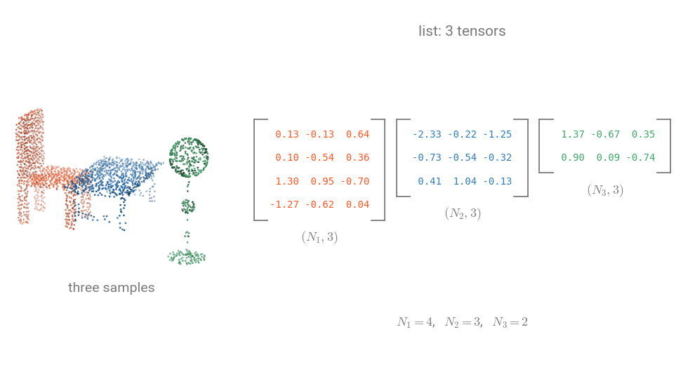

# Data format

A sample is a `dict` of tensors. The keys are plain strings, listed in `DataKeys` (`torch_pointcloud.utils.data`), so
`data["pos"]` and `data[DataKeys.POS]` are the same entry. A dataset returns samples, a transform returns a new one,
and `collate` packs a list of them into a batch.

## Packed batches

Batches are packed, as in :pyg: [PyTorch Geometric](https://pytorch-geometric.readthedocs.io/): the clouds are
concatenated along the first axis and a `batch` index tells which cloud each point belongs to. Nothing is padded, so
clouds of different sizes batch together, and `pos[batch == i]` is cloud $i$.



Models take packed tensors, `model(x, pos, batch)` for most of them, never a $(B, N, 3)$ tensor. Outputs follow the
same layout: $(B, \text{num\_classes})$ logits for classification, $(N, \text{num\_classes})$ for segmentation, and
packed boxes from `decode` for detection.

## Keys

Per-point tensors have one row per point.

| Key         | Shape    | Dtype            | Meaning                                                                      |
| ----------- | -------- | ---------------- | ---------------------------------------------------------------------------- |
| `pos`       | $(N, 3)$ | float32          | Coordinates                                                                  |
| `x`         | $(N, C)$ | float32          | Input features of the model (color, normals, height, ...), built by the transform |
| `batch`     | $(N,)$   | int64            | Cloud index of each point, written by `collate`                              |
| `color`     | $(N, 3)$ | uint8 or float32 | RGB, in $[0, 255]$ or $[0, 1]$ depending on the dataset                     |
| `normal`    | $(N, 3)$ | float32          | Normals                                                                      |
| `intensity` | $(N, 1)$ | float32          | LiDAR intensity                                                              |
| `return_number` | $(N, 1)$ | int64        | LiDAR return number, 1-based                                                 |
| `number_of_returns` | $(N, 1)$ | int64    | Number of returns of the LiDAR pulse                                         |
| `segment`   | $(N,)$   | int64            | Semantic label, see [ignore index](#ignore-index)                            |
| `instance`  | $(N,)$   | int64            | Instance id, $-1$ when none                                                  |

Per-sample values have no point axis: `label` (int64 scalar, the class of the cloud), `category` (int64 scalar, the
object category in part segmentation) and `name` (str).

Detection samples carry $K$ boxes per scene:

| Key         | Shape    | Dtype   | Meaning                                                           |
| ----------- | -------- | ------- | ----------------------------------------------------------------- |
| `box`       | $(K, 7)$ | float32 | $(c_x, c_y, c_z, d_x, d_y, d_z, \theta)$: center, size, heading  |
| `label`     | $(K,)$   | int64   | Class of each box                                                 |
| `velocity`  | $(K, 2)$ | float32 | $(v_x, v_y)$, nuScenes only                                       |
| `batch_box` | $(K,)$   | int64   | Scene index of each box, written by `collate`                     |

Some models read other keys: a voxel grid (`voxel`, `pos_voxel`, `voxel_num_points` from `HardVoxelize`), integer
coordinates (`pos_grid` from `Voxelize`) or an `octree`. `info["input_keys"]` lists what a checkpoint needs and
`select_inputs` picks them from the batch:

```{.python notest}
import torch
import torch_pointcloud as tp
from torch_pointcloud.utils.data import collate, select_inputs

model, info = tp.create_model("pointnet.modelnet40", return_info=True)
batch = collate([info["transform"]({"pos": torch.rand(2048, 3)})])
logits = model(*select_inputs(batch, info["input_keys"]))
```

## Collation

`collate` turns a list of samples into one batch:

- tensors are concatenated along the first axis, scalars are stacked to $(B,)$, strings go in a list;
- `batch` is built from `pos`;
- `stack_keys` are stacked along a new first axis instead, for per-scene tensors of a fixed size;
- `cat_keys` are concatenated and get a `batch_<key>` index, for per-scene tensors of a varying size such as `box`.

```{.python notest}
from torch_pointcloud.utils.data import PointCloudDataLoader

dataloader = PointCloudDataLoader(dataset, batch_size=8, cat_keys=["box", "label"])
data = next(iter(dataloader))
data["box"].shape, data["batch_box"].shape  # (K, 7), (K,)
```

`PointCloudDataLoader` is a `DataLoader` with this `collate` as `collate_fn`. Datasets do not set these arguments:
a transform may add keys, so the caller does.

## Sampling keys

A transform that changes the number of points can record how to get back to the input cloud:

| Key              | Shape                  | Meaning                                                                                                   |
| ---------------- | ---------------------- | --------------------------------------------------------------------------------------------------------- |
| `origin_pos`     | $(N_\text{origin}, 3)$ | Copy of the input cloud, made by `CopyItems` at the head of the pipeline                                  |
| `origin_segment` | $(N_\text{origin},)$   | Copy of the input labels                                                                                  |
| `inverse`        | $(N_\text{origin},)$   | Input row to output row, from `Voxelize` and `DivisiblePad` (`dst_inverse_key`): `preds[inverse]` scores every input point |
| `index`          | $(N,)$                 | Output row to input row, from the samplers (`dst_index_key`): `origin_pos[index]` is `pos`                |

The registered pipelines set them. Chained samplers compose them, so they always point at the input of the pipeline.
After `collate`, pass them in `cat_keys` and shift them with `offset_index` to index the packed batch.

## Ignore index

Each dataset marks unlabeled points its own way: $0$ in ScanNet and the outdoor datasets, $-1$ for ScanNet instances,
nothing in S3DIS. The transform of a checkpoint relabels `segment` to the value the model was trained with: $-1$ for
the ScanNet and S3DIS models, $255$ for the SemanticKITTI, nuScenes and DGCNN ScanNet models. Pass that value as
`ignore_index` to the loss and to `confusion_matrix`.
