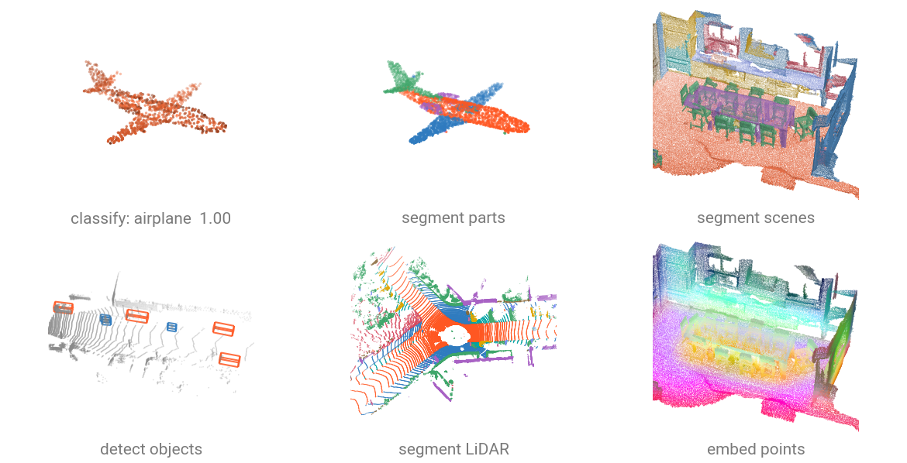

# Models

:pytorch-pointcloud-mini: `torch-pointcloud` ships architectures for point cloud classification, semantic, part and
instance segmentation, object detection and self-supervised pretraining, behind one :pytorch: timm-style factory:

```{.python notest}
import torch_pointcloud as tp

model = tp.create_model("pointnext-sm.scanobjectnn-hardest.openpoints", pretrained=True)
tp.list_models(task="classification", pretrained=True)  # or "semantic-segmentation", "detection", ...
```

Weights are downloaded from the Hugging Face Hub on first use and cached under `~/.cache/torch-pointcloud/models`
(`TORCH_POINTCLOUD_CACHE_DIR` moves the cache). Each checkpoint keeps the license of its source, listed on the task pages,
and a few are restricted to non-commercial use: see
[`THIRD_PARTY_NOTICES.md`](https://github.com/arthurdjn/pytorch-pointcloud/blob/main/THIRD_PARTY_NOTICES.md).



## Tasks

<div class="grid cards" markdown>

-   :material-shape-outline: __[Classification](classification.md)__

    One label per cloud: run, evaluate and fine-tune a classifier.

-   :material-floor-plan: __[Semantic segmentation](segmentation.md)__

    One label per point: voxelization, full-resolution predictions, mIoU.

-   :material-puzzle-outline: __[Part segmentation](part-segmentation.md)__

    Category-conditioned part labels and the ShapeNetPart protocol.

-   :material-select-group: __[Instance segmentation](instance-segmentation.md)__

    One mask per object: superpoints, decoded masks, mask AP.

-   :material-cube-scan: __[Object detection](detection.md)__

    Oriented boxes: decode, filter with NMS, score with mAP.

-   :material-palette-swatch: __[Feature maps](features.md)__

    The representation under the head: embeddings, retrieval, PCA.

</div>

## Scores

Every pretrained checkpoint is evaluated with the protocol of its reference implementation. The plot compares the
measured score with the published one, and each task page lists the numbers.

{{ parity_plot() }}

## Architectures

### Classification

Best for **shape classification** (ModelNet40, ScanObjectNN, ShapeNet objects). Inputs are single object scans, outputs are scene-level class predictions.

{{ architecture_table("classification") }}

### Segmentation

Best for **dense per-point labeling** (S3DIS, ScanNet, SemanticKITTI). Inputs are large scenes, outputs are per-point class predictions.

{{ architecture_table("semantic-segmentation") }}

### Part segmentation

Best for **object parts** (ShapeNetPart). Inputs are single objects and their category, outputs are per-point part labels.

{{ architecture_table("part-segmentation") }}

### Instance segmentation

Separate **every object of a scene**: indoor objects (ScanNet) or individual trees (FOR-instance). Inputs are large
scenes, outputs are one point mask, class and score per object.

{{ architecture_table("instance-segmentation") }}

### Detection

Predict **3D bounding boxes** for indoor scenes (ScanNet, SUN RGB-D) or driving scenes (KITTI, nuScenes, Waymo).

{{ architecture_table("detection") }}

### Self-supervised pretraining

Backbones pretrained without labels, registered with `task="pretraining"`; the fine-tuned classification / segmentation heads are registered under their downstream task.

{{ architecture_table("pretraining") }}
